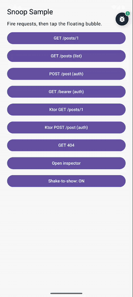

# Snoop

Drop-in, agent-ready feedback and network diagnostics overlay for **Android
Compose** apps. Capture annotated screens, crash context, action breadcrumbs,
logs and replayable HTTP evidence in named sessions, then export one Markdown
payload for an AI coding agent. Inert in release builds.

> Status: agent-ready feedback is currently unreleased on `main`; the latest
> published `0.2.x` artifacts contain the network inspector.

## Demo



Drag the bubble and tap it to open the Debug Hub. From there, inspect every
OkHttp / Ktor request, capture visual feedback, manage sessions and open network
tools.

## Features

- 🐞 **Draggable debug bubble** with a request-count badge (green / amber / red), anchored top-right — auto-attached to every activity, no code in your UI tree
- 🧰 **Debug Hub** — one tap exposes Inspector, Capture Feedback, Sessions, Network Tools, diagnostic logs and host-defined actions
- 🪟 **Dialog inspector** (not a separate screen) with search and ALL / ERR / PEND filters
- 🌳 **Collapsible JSON tree** — expand/collapse request & response bodies with `[+]`/`[-]`
- 📋 **Copy buttons** per request: FULL, REQUEST, RESPONSE, ENDPOINT, **cURL**, plus a global **ALL COPY LOG**
- 🙈 **Hide** the overlay from the Debug Hub; restore with `Snoop.show()`
- 📳 **Shake to reveal** — shake the device to bring a hidden bubble back; toggle off with `Snoop.shakeToShow = false`
- 📌 **Feedback sessions** — isolate a test run, resume it later, then close and export one AI-ready Markdown report
- ✍️ **Visual capture** — annotate the live app UI through a transparent capture layer, then review pins, category and notes in one focused sheet
- 💥 **Crash recovery** — persist stack trace, last-known-good screenshot, device info, breadcrumbs and recent logs for the next launch
- 🧭 **Action context** — bounded activity/touch breadcrumbs plus a privacy-safe accessibility snapshot
- 🧪 **Response mock + replay** — edit a captured response into an OkHttp/Ktor mock and replay earlier requests on-device
- 🤖 **Send selected pins to Claude** — tick the pins that matter and hand them straight to the Claude Android app; falls back to the system chooser when it is not installed
- 🖥️ **Export selected pins to your IDE** — the same selection goes through the desktop bridge into your project files, beside the full-session export
- 🖥️ **ADB/MCP bridge** — list, read and pull feedback sessions directly from an AI agent on the development computer
- 🔌 **OkHttp & Ktor** capture — a single interceptor or one client plugin (transport-agnostic core)
- 🧩 **Custom sections** — inject your own debug controls (env switch, feature flags…) into the Debug Hub
- 🚫 **No-op in release** — a separate artifact strips everything out

## Modules

| Artifact | Purpose |
|----------|---------|
| `snoop-core` | Compose UI overlay + in-memory log store |
| `snoop-okhttp` | OkHttp `Interceptor` that feeds the store |
| `snoop-ktor` | Ktor client plugin that feeds the store |
| `snoop-no-op` | Empty drop-in replacement for release builds |
| `daemon` | Local JVM MCP server that reads debug sessions through ADB |

## Install

```kotlin
dependencies {
    // Pick the adapter matching your HTTP client (both pull in snoop-core):
    debugImplementation("io.github.alihansarigit:snoop-okhttp:0.2.0")   // OkHttp
    // debugImplementation("io.github.alihansarigit:snoop-ktor:0.2.0")  // Ktor
    releaseImplementation("io.github.alihansarigit:snoop-no-op:0.2.0")
}
```

`snoop-okhttp` and `snoop-ktor` each pull in `snoop-core` transitively — add both
if your app mixes clients. `snoop-no-op` mirrors every adapter's public API, so the
release swap compiles unchanged. While unpublished, use a local build: run
`./gradlew publishToMavenLocal` and add `mavenLocal()` to your repositories.

## 🤖 Let an AI integrate it

Open your project in an AI coding assistant (Claude Code, Cursor, Copilot Chat,
ChatGPT…) and paste the prompt below. On GitHub, hover the block and click the
**copy icon** in its top-right corner.

```text
Add the Snoop network-inspector library to my existing Android app. Snoop is a
drop-in debug overlay: a draggable bubble floats over debug builds and lets me
inspect every OkHttp request/response (status, timing, headers, pretty-printed
JSON). It is inert in release builds via a separate no-op artifact.

Integrate it, adapting to my build setup and code style:

1. Gradle dependencies — add to the app module and KEEP the debug/release split
   exactly (real library in debug only, no-op in release only):
       debugImplementation("io.github.alihansarigit:snoop-okhttp:0.2.0")
       releaseImplementation("io.github.alihansarigit:snoop-no-op:0.2.0")
   Make sure mavenCentral() is in the repositories. snoop-okhttp pulls in
   snoop-core transitively. If I use a version catalog (libs.versions.toml),
   put the coordinates there and reference them.

2. Interceptor — find where I build OkHttpClient and add it LAST, so it sees the
   final request:
       import io.github.alihansarigit.snoop.okhttp.SnoopInterceptor
       OkHttpClient.Builder()
           .addInterceptor(SnoopInterceptor())
           .build()
   The constructor arg is optional: SnoopInterceptor(maxBodyBytes = 250_000L).
   Add it to every client whose traffic I want to see.

3. Nothing else is required — the bubble auto-installs via androidx.startup.
   The io.github.alihansarigit.snoop.Snoop object is optional:
       Snoop.registerSection("Env") { /* @Composable debug controls */ }
       Snoop.launchInspector(context)   // open the inspector directly
       Snoop.hide() / Snoop.show() / Snoop.clear()
       Snoop.shakeToShow = false         // disable shake-to-reveal (default on)

Rules:
- The app is Jetpack Compose; activities are ComponentActivity/AppCompatActivity.
- This recipe wires the OkHttp adapter; if I use Ktor, install the `snoop-ktor`
  plugin instead: `HttpClient(engine) { install(SnoopKtor) }`.
- Reference the Snoop API from debug-only code paths — the no-op artifact ships
  the same class names with empty bodies, so debug-only usage keeps release clean.
- Show me the exact diffs, then the Gradle sync/build command to run.
```

## Usage

Add the interceptor to your OkHttp client. That's it — the bubble auto-installs
through `androidx.startup`.

```kotlin
val client = OkHttpClient.Builder()
    .addInterceptor(SnoopInterceptor())
    .build()
```

### Ktor

Using Ktor instead? Install the plugin on your `HttpClient` — same overlay, same
store. Works with any engine (CIO, OkHttp, Android…).

```kotlin
import io.github.alihansarigit.snoop.ktor.SnoopKtor

val client = HttpClient(engine) {
    install(SnoopKtor)
    // optional: cap captured bodies (default 250 KB)
    // install(SnoopKtor) { maxBodyBytes = 500_000 }
}
```

### Custom sections (optional)

```kotlin
Snoop.registerSection("Environment") {
    // any @Composable — appears under Custom tools in the Debug Hub
    EnvironmentSwitch()
}
```

### Manual control (optional)

```kotlin
Snoop.hide()                 // hide the bubble (same as Hide overlay in the Debug Hub)
Snoop.show()                 // bring it back
Snoop.clear()                // clear captured logs
Snoop.launchInspector(ctx)   // open the logs dialog directly
Snoop.shakeToShow = false    // opt out of shake-to-reveal (default: on)
```

### Agent-ready feedback sessions

```kotlin
val sessionId = Snoop.startSession("Checkout flow")

Snoop.setFeedbackScreenContext(
    routeName = "checkout",
    subScreen = "payment",
    screenFileHint = "CheckoutScreen.kt",
)

Snoop.recordAction(
    tag = "checkout_submit",
    action = "tap",
    metadata = mapOf("cartSize" to "3"),
)
Snoop.log("CheckoutViewModel", "Submitting cart")
Snoop.launchCapture(activity) // tap to pin, drag to crop, annotate, add voice/text notes

val markdownPath = Snoop.closeSession() // files/snoop/feedback/sessions/.../feedback.md
```

Shaking opens the capture surface by default. The inspector also exposes
**FEEDBACK**, **SESSIONS**, manual log capture, per-request **MOCK**, and
**REPLAY** actions. Custom tags survive in the session item:

Capture mode starts in **PIN / REGION** on top of the live app UI. The clean
screenshot stays in memory for crops and export; it is not rendered as a second
copy of the screen:

- tap a target to create an editable numbered pin;
- drag over a target to attach a cropped region to the pin;
- use **+ ADD REGION** to associate several crops with one agent task;
- tap an existing marker or open **REVIEW** to review, edit, delete or copy the
  draft tasks as Markdown;
- switch to **PEN**, **CIRCLE** or **ARROW** when free-form annotation is more
  useful.

```kotlin
Snoop.addFeedbackCategory("Accessibility", 0xFF0891B2.toInt())
```

### Response mocks

```kotlin
val mockId = Snoop.addNetworkMock(
    method = "GET",
    urlPattern = "https://api.example.com/users/*",
    statusCode = 503,
    body = """{"error":"temporarily unavailable"}""",
)

Snoop.removeNetworkMock(mockId)
Snoop.clearNetworkMocks()
```

Mocks are in-memory and debug-only. Both OkHttp and Ktor adapters consult the
same registry before touching the network.

### Crash recovery

Snoop never swallows a fatal exception. It writes a bounded crash envelope,
delegates to the host/Android exception handler, and presents the recovered
report the next time the application process launches. This avoids continuing
with corrupted application state.

### Developer actions

Host-owned environment, feature-flag, cache or restart operations can be added
without giving the SDK direct access to application storage:

```kotlin
Snoop.registerDeveloperAction("Use staging", Runnable {
    environmentStore.select("staging")
    Snoop.restartApp(context)
})
```

### Send sessions to your project

Apply the Gradle plugin to the Android application module:

```kotlin
plugins {
    id("com.android.application")
    id("io.github.alihansarigit.snoop") version "0.2.2"
}
```

That is the whole setup. The plugin attaches a bridge to the install tasks, so
pressing Run in the IDE leaves a daemon listening on host loopback; no terminal
command is involved. The Sessions screen then shows a green desktop status, and
**Send to project** writes the bundle to:

```text
<project>/agent-feedback/<transfer-day>/<application-id>/<session>/
├── full/                       ← Send to project
│   ├── feedback.md
│   ├── manifest.json
│   ├── attachments/
│   └── <session-id>-agent-feedback.zip
└── pin2-5-7/                   ← Export to IDE, named after the ticked pins
    ├── feedback.md
    ├── manifest.json
    └── attachments/
```

`<session>` is the session id's random suffix — the day already names the parent
directory, and the full id stays in `manifest.json`. The ZIP is extracted next
to itself, so an agent can read `feedback.md` directly. Add `agent-feedback/` to
`.gitignore` — the bundles carry screenshots and captured request bodies.

Tick individual pins and **EXPORT TO IDE** sends only those. Its `feedback.md`,
`manifest.json` and attachments are filtered to the ticked pins, so unselected
work does not travel with them, and its own directory means a partial export
never replaces the full one.

#### Which project receives a session

The plugin passes the root project of the build that applied it, so a session
can only reach the project you pressed Run on. Two further rules keep a second
app out of it:

- the bridge is restricted to one debug application id and rejects any other,
  so another app's Sessions screen shows a red status instead of quietly
  exporting here;
- the start task refuses to run when another project's bridge already holds the
  port, rather than letting feedback land in that project.

**With product flavors the first rule needs your help.** The application id is
read from the single debuggable variant; with `devDebug` and `prodDebug` there
is no single answer, so the restriction is dropped and the bridge accepts any
package. Set it explicitly:

```kotlin
snoop {
    applicationId = "com.example.app.dev"
}
```

To run two projects at once, give each its own port and match it in the app
through `SnoopConfig.desktopBridgePort`.

Defaults can be changed, and the tasks can also be driven by hand:

```kotlin
snoop {
    autoStart = true            // hook into installDebug
    port = 8737                 // must match Snoop.config.desktopBridgePort
    idleTimeoutMinutes = 480    // 0 keeps the bridge alive indefinitely
    applicationId = "com.example.app.debug"  // only with several debug variants
}
```

```bash
./gradlew snoopBridge        # start it without installing
./gradlew snoopBridgeStop    # stop the bridge this project started
```

The daemon only binds loopback, maintains `adb reverse` for authorized devices,
constrains every write to the directory chosen at startup, and refuses bundles
from an application id other than the configured one. When another project
already holds the port the build fails with an explanation instead of quietly
sending feedback to the wrong repository.

No desktop at hand? **SAVE ZIP** in the session detail writes the same bundle to
the device's own `Download/Snoop/` folder, ready for `adb pull`.

### MCP

For an agent that should read sessions on its own, the same daemon also runs as
an MCP stdio server. See [docs/MCP.md](docs/MCP.md).

### Shake to reveal

After you choose **Hide overlay** in the Debug Hub, give the device a firm shake to bring it
back — handy when you don't want to keep the overlay on screen but still need it a
tap away. It's on by default; disable it with `Snoop.shakeToShow = false` (e.g. if
your app already uses shake for something else). Uses the accelerometer only while an
activity is in the foreground, and needs no permission.

## How release stripping works

`snoop-no-op` ships the **same public classes** (`Snoop`,
`SnoopInterceptor`) with empty bodies. Because you depend on the real modules
only via `debugImplementation` and the no-op via `releaseImplementation`, release
builds compile unchanged and capture nothing — zero overhead, no logs in
production.

## Limitations

- Host activities must be `ComponentActivity`/`AppCompatActivity` (standard for
  Compose apps) — the bubble relies on the view-tree lifecycle owner.
- Capture adapters: OkHttp and Ktor. In-memory (text/JSON) bodies are captured;
  streaming request bodies and Server-Sent Event responses are recorded
  metadata-only, so the stream is never disturbed.
- Fatal UI-thread exceptions cannot be safely recovered in-process. Snoop
  restores the report on the next launch.
- Arbitrary Compose `testTag` values are not externally enumerable. Snoop uses
  accessibility metadata and the explicit `recordAction` hook.
- Logcat access varies by Android/OEM build. Explicit `Snoop.log` entries are
  always available; process Logcat ingestion is best-effort.
- Native speech recognition availability and offline support depend on the
  device recognizer.
- Session sync uses an authorized ADB device. Wi-Fi ADB works after the device
  has been paired by the developer.

## Building

```bash
./gradlew :sample:assembleDebug      # demo app with the live overlay
./gradlew runOnEmulator              # boot an emulator, install & launch the sample
./gradlew publishToMavenLocal        # publish libraries to ~/.m2
./gradlew :daemon:installDist        # install the local ADB/MCP bridge
```

`runOnEmulator` boots the `Pixel_8_Pro` AVD (reusing any already-connected device),
installs the debug sample, and launches it so the overlay is live. Pick a different
AVD with `-Psnoop.avd=<name>`, or just boot one with `./gradlew bootEmulator`.

See [docs/PUBLISHING.md](docs/PUBLISHING.md) for Maven Central release steps.

## License

Apache-2.0 — see [LICENSE](LICENSE).
